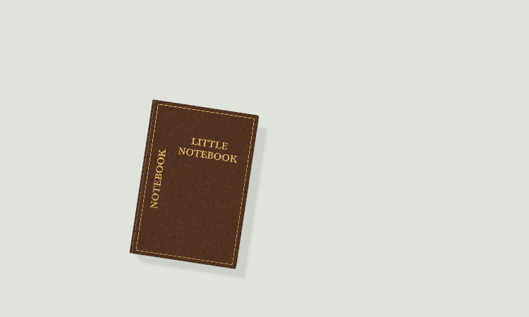
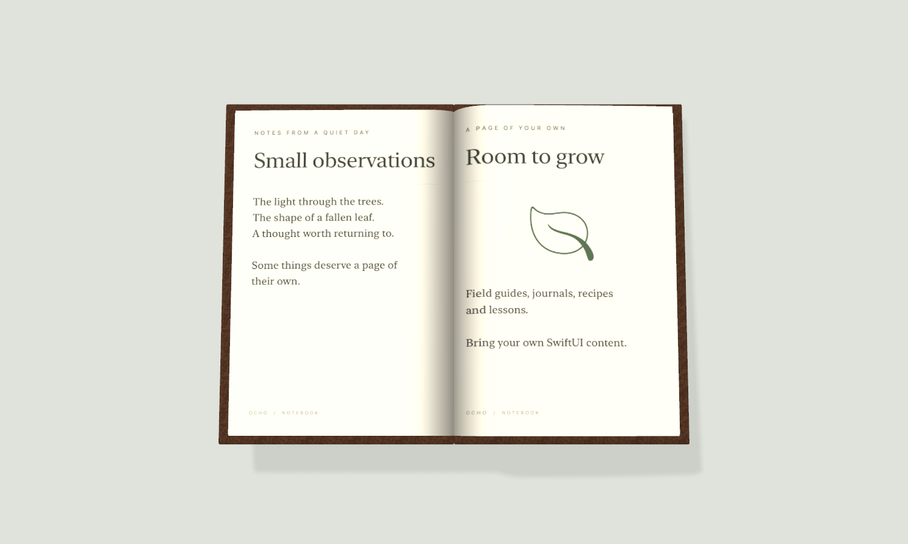
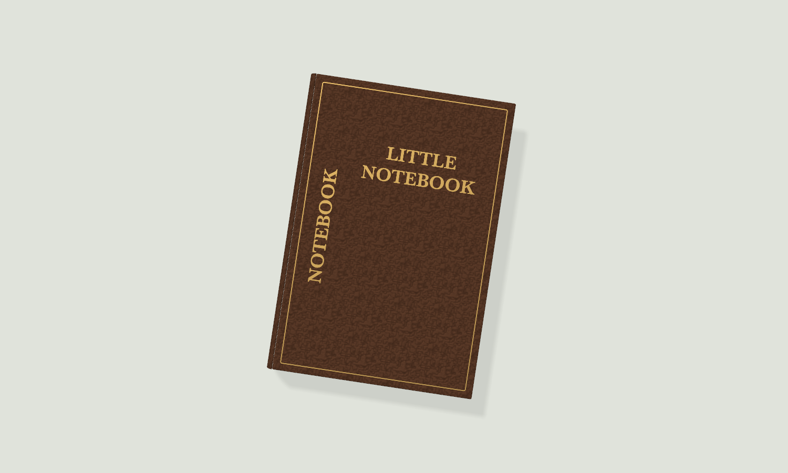
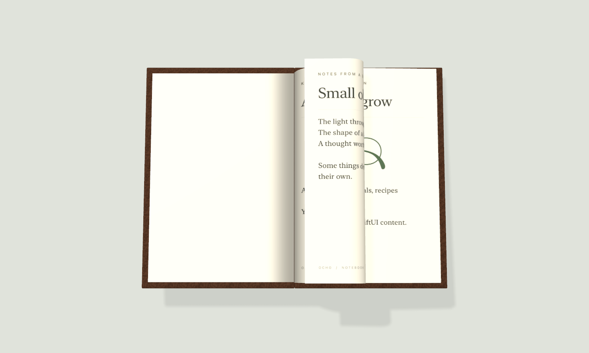
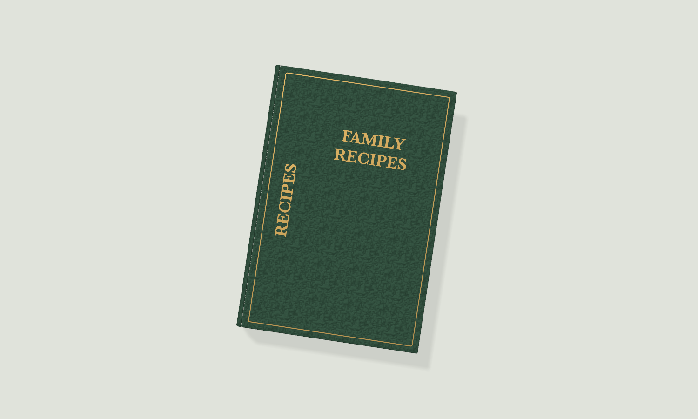
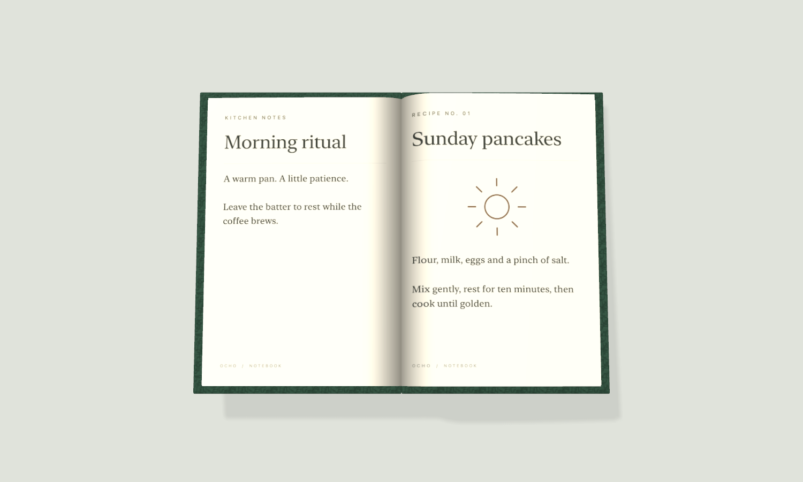

# Notebook

A reusable SceneKit book for SwiftUI apps. A leather cover lifts from the screen's edge, opens, and folds real page geometry under your finger. Extracted from Zen Garden's field guide, with app content and persistence removed.



- Animated cover, page curl, tap/swipe turning, riffling, pinch and drag-to-close.
- One reading page in portrait; a two-page spread in landscape.
- Custom SwiftUI pages, cover lettering/colors, lighting and edge placement.
- Independent controller per book; no singleton, assets, network calls, analytics or external dependencies.
- Procedural page sounds, opt-in. Page textures load near the current spread and are released after closing.

**Requirements:** iOS/iPadOS 18+, Xcode 26+ with Swift 6.2. The package compiles in Swift 5 language mode and can be imported by Swift 6 apps. macOS 15 is declared solely to run portable geometry/audio tests; the public book UI is iOS-only. SceneKit is the retained rendering backend. No native macOS, tvOS or visionOS UI is provided.

## A look inside

The same book can hold a field guide, a journal, recipes, or lessons. These examples use custom SwiftUI pages and two cover styles.



| Leather and gold foil | A page mid-fold |
| --- | --- |
|  |  |

| Another cover, another app | Your own content |
| --- | --- |
|  |  |

*Rendered offscreen from the package's actual SceneKit engine and SwiftUI page snapshots. The animation uses its real springs; staging keeps the closed cover fully visible. These are documentation fixtures, not device screenshots. [Reproduce the images](Documentation/VisualExamples.md).*

## Install

In Xcode, choose **File → Add Package Dependencies**, enter:

```text
https://github.com/ocho-git/notebook.git
```

Choose **Up to Next Minor Version** from **0.1.0**, then add the **Notebook** product to your iOS app target. Authenticate with a GitHub account that can read this private repository. CI also needs private-repository access; never commit credentials.

For a Swift package:

```swift
.package(url: "https://github.com/ocho-git/notebook.git", .upToNextMinor(from: "0.1.0"))
```

Add `.product(name: "Notebook", package: "notebook")` to the target's dependencies.

## Use

```swift
import Notebook
import SwiftUI

struct RecipeScreen: View {
    @State private var book = NotebookController(
        document: NotebookDocument(leaves: [
            NotebookLeaf(
                recto: .text(title: "Family recipes", body: "A few things worth keeping."),
                verso: .text(title: "Notes", body: "Use seasonal ingredients.")
            ),
            NotebookLeaf(recto: .text(title: "Pancakes", body: "Mix, rest, and cook in a warm pan."))
        ]),
        cover: NotebookCover(title: "FAMILY\nRECIPES", spineTitle: "RECIPES")
    )

    var body: some View {
        ZStack {
            Color.gray.opacity(0.15).ignoresSafeArea()
            NotebookView(controller: book)
        }
    }
}
```

Keep the controller in `@State` (or a stable host-owned model). Give the view a full-screen container. Closed, only the small book at the edge intercepts touches. Place app toolbar controls **above** `NotebookView` in the ZStack.

## Demo

Open [`Demo/NotebookDemo.xcodeproj`](Demo/NotebookDemo.xcodeproj), choose **NotebookDemo**, select your signing team if using a physical device, and run. The demo references the local package and includes both text and a custom illustrated SwiftUI page. XcodeGen is **not required** to open the checked-in project; to regenerate it after editing `Demo/project.yml`, run `xcodegen generate --spec Demo/project.yml`.

Tap the cover or **Open notebook**. Tap/swipe pages, rotate to landscape, use **First page** to riffle back, then drag down, pinch inward, tap outside, or use **Close**. Enable **Page sounds** to hear the procedural paper audio.

## Give an assistant this instruction

> Add the private Swift package https://github.com/ocho-git/notebook.git (product/module Notebook), version 0.1.0 up to the next minor version. Read its README, Documentation/Integration.md and AGENTS.md first. Use NotebookController held in @State and NotebookView to build a book for [X]. Supply our content with NotebookDocument, NotebookLeaf and NotebookPage. Keep all app data, persistence and audio-session policy in our app. Follow the bundled demo rather than copying or recreating the SceneKit engine.

See [integration details](Documentation/Integration.md), [architecture and extraction scope](Documentation/Architecture.md), and [validation](Documentation/Validation.md).

## Check

```sh
./scripts/check.sh
```

This runs geometry/audio tests on the Mac and unsigned builds of the demo for generic iOS and iOS Simulator destinations. It does not boot a simulator or launch an app.

Private Ocho source; see [LICENSE](LICENSE).
